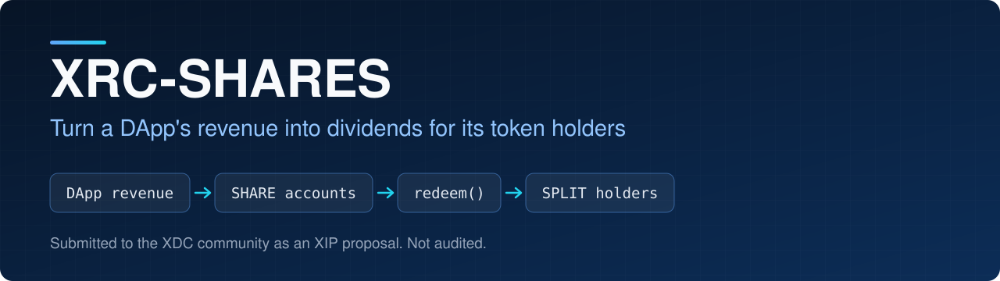
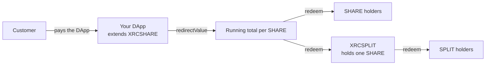

<p align="center">
  
</p>

<p align="center">
  
<a href="https://github.com/CoinClubQuincy/XRC-SHARES/actions/workflows/build.yml"></a>        
</p>

<p align="center">
  <a href="#how-it-works">How it works</a> · <a href="#try-it">Try it</a> · <a href="#what-is-tested">What is tested</a> · <a href="#known-issues">Known issues</a>
</p>

A SHARE is an NFT that represents a piece of a DApp. Money paid to the contract is divided evenly across every share, and each holder withdraws what their shares have earned. A SPLIT divides one SHARE into smaller dividend tokens, and SPLITS can themselves be split.

> [!WARNING]
> This is a proposal. It has not been audited and has not run on a real network. Read [Known issues](#known-issues) before sending real funds to it.

## Why use it

| You want to | With SHARES |
| --- | --- |
| Sell part of a DApp | Sell share tokens, which are ordinary ERC-1155 tokens |
| Pay holders automatically | Send fees to the contract and every share is credited, at the same cost however many shares exist |
| Let holders use access control or voting | Check `balanceOf` for a share in your own contract |
| Offer smaller stakes | Put a SHARE into a SPLIT contract and sell the splits |

## How it works



Inherit `XRCSHARE` and forward fees from any payable function:

```solidity
contract LemonadeStand is XRCSHARE {
    uint public lemonadeCount;

    constructor(string memory _name, string memory _symbol, uint _totalSupply, string memory _URI)
        XRCSHARE(_name, _symbol, _totalSupply, _URI) {}

    function GlassOfLemonade() public payable returns (bool) {
        require(msg.value >= 10 ether, "need more funds");
        lemonadeCount++;
        redirectValue(msg.value); // credits every share
        return true;
    }
}
```

| Contract | Function | What it does |
| --- | --- | --- |
| `XRCSHARE` | `constructor` | Mints one token per share to the deployer, up to 1,000 shares |
| `XRCSHARE` | `viewAccount(token)` | Unclaimed funds for one share |
| `XRCSHARE` | `viewAccountTotal()` | Unclaimed funds across the caller's shares |
| `XRCSHARE` | `redeem()` | Pays the caller for every share they hold |
| `XRCSPLIT` | `activateContract(share)` | Takes in one SHARE and mints the splits to the caller |
| `XRCSPLIT` | `redeem()` | Pulls the SHARE's dividends, then pays the caller's splits |
| `XRCSPLIT` | `redeemShard()` | Pays out what the splits earned, burns them and returns the SHARE. The caller must hold every split |

> [!IMPORTANT]
> Before calling `activateContract`, call `setApprovalForAll(splitAddress, true)` on the SHARE contract.

Unclaimed dividends stay with the token. If a share is sold, the new holder can redeem what it has already earned. This includes activating a SPLIT: anything the SHARE has not yet paid out goes to the split holders, so redeem first if you want to keep it.

A SPLIT can hold a SHARE or a split from another SPLIT. Its `viewAccount` returns three values: what the split holds here, what it would receive from its source, and the total.

The full write-up, including generations of SPLITS and how DApps can use them, is in [docs/WRITEUP.md](docs/WRITEUP.md). To comment on the proposal, use the [XDC XIP repository](https://github.com/XDC-Community/XIPs.github.io).

## Try it

```bash
git clone https://github.com/CoinClubQuincy/XRC-SHARES.git
cd XRC-SHARES
git clone --depth 1 -b v4.9.6 https://github.com/OpenZeppelin/openzeppelin-contracts lib/openzeppelin-contracts
git clone --depth 1 -b v1.9.7 https://github.com/foundry-rs/forge-std lib/forge-std
forge test
```

You need [Foundry](https://getfoundry.sh).

To try it on a network, use the Apothem testnet:

| Network | Chain ID | RPC |
| --- | --- | --- |
| Apothem testnet | 51 | `https://rpc.apothem.network` |
| XDC mainnet | 50 | `https://rpc.xinfin.network` |

```bash
forge create contracts/SHARE.sol:XRCSHARE --rpc-url https://rpc.apothem.network --interactive --broadcast --legacy \
  --constructor-args "My DApp" "MDA" 100 "https://example.com/{id}.json"
```

## What is tested

[`test/foundry/Share.t.sol`](test/foundry/Share.t.sol) has 29 tests, including one fuzz test, and runs in CI on every push.

| Tested | Not tested |
| --- | --- |
| Minting, the 1,000 share cap and even splitting | A real network, testnet or mainnet |
| Redeeming only the shares you hold, and dividends moving with a sold token | An independent security audit |
| Failed payouts reverting and keeping the balance, and a reentrant holder being paid once | Whether the XIP text matches this code |
| Payment gas not depending on the number of shares | |
| `redeemShard()`, including every missing-split position and amounts too small to divide | |
| Activating again without owing anything stale | |
| A SPLIT of a SPLIT, for viewing, paying and `redeemShard()` | |
| Fuzz: nobody withdraws more than was paid, and the contracts stay solvent | |

The test `test_GasForAPaymentDoesNotDependOnTheNumberOfShares` measured about 28,000 gas for the first payment to 1,000 shares. The earlier version used about 20.6 million.

## Changes from earlier versions

Contracts already deployed are unaffected and keep the old behaviour. The XIP text and [docs/WRITEUP.md](docs/WRITEUP.md) describe the original proposal and were not changed.

- Payments now update one running total per contract instead of writing to every share. New public values: `perShareAccrued` and `remainder`.
- `accounts(token)` is now a view with the same return values. `exist` is false for a token that does not exist.
- What does not divide evenly now carries into the next payment instead of staying uncredited.
- `redeem()` reverts if the payout fails, so a holder no longer loses their balance.
- `redeemShard()` pays out what the splits earned before burning them. It also now checks every split. It used to check only every other one.
- A SPLIT of a SPLIT now reads its source correctly.
- `viewAccount` on a SPLIT shows nothing before activation. It used to report share 0.
- A SPLIT refuses payments before activation, refuses any token except the SHARE being activated, and no longer has `onERC721Received` or `onERC1155BatchReceived`.
- The constructor refuses zero shares, and both limits now have clear revert messages.

## Known issues

| Issue | Effect | Test |
| --- | --- | --- |
| Paying with Solidity's `transfer` or `send` fails | These forward 2,300 gas, and recording a payment writes to storage, which costs more than that. Pay with `call` instead. This is an EVM limit | `test_KnownLimit_PaymentWith2300GasFails` |
| `redirectValue` trusts its input | It credits whatever amount you pass. Pass only value the contract actually received, or later redeems will run out of funds | Read from the code |
| Redeeming costs more with more shares | `redeem()` and `viewAccountTotal()` check each share, up to 1,000 | Read from the code |
| Small amounts can wait | Up to one wei per share can stay in `remainder` until the next payment, and each generation of SPLITS holds its own | The fuzz test |

<details>
<summary><strong>More XDC projects</strong></summary>

| Group | Project | What it is |
| --- | --- | --- |
| Standards | [XRCDividendPlus](https://github.com/CoinClubQuincy/XRCDividendPlus) | Dividend-paying XRC-20 token |
| Treasury and finance | [Multi-Sig-Treasury](https://github.com/CoinClubQuincy/Multi-Sig-Treasury) | Treasury controlled by tokenized keys |
| Treasury and finance | [XRC-Airdrop](https://github.com/CoinClubQuincy/XRC-Airdrop) | Self-run token airdrop |
| Treasury and finance | [XRC-Credit](https://github.com/CoinClubQuincy/XRC-Credit) | Debt contract skeleton |
| Treasury and finance | [XDC-Defi-Instruments](https://github.com/CoinClubQuincy/XDC-Defi-Instruments) | Assets, agreements, forwards, futures and a marketplace |
| Identity and access | [LoginMFAContract](https://github.com/CoinClubQuincy/LoginMFAContract) | Login with a password and an NFT |
| Identity and access | [PrivateAccessToken](https://github.com/CoinClubQuincy/PrivateAccessToken) | Token-gated contract data demo |
| Identity and access | [Delegated_Authority](https://github.com/CoinClubQuincy/Delegated_Authority) | KYC notary proof of concept |
| Learning and libraries | [XDC-LemonadeStand](https://github.com/CoinClubQuincy/XDC-LemonadeStand) | Workshop DApp built on XRC-SHARES |
| Learning and libraries | [Non-Financial-SmartContracts](https://github.com/CoinClubQuincy/Non-Financial-SmartContracts) | Games, inventory, keys and on-chain repositories |
| Tools | [XDC_Python_SDK_V1](https://github.com/CoinClubQuincy/XDC_Python_SDK_V1) | Python client for the XDC JSON-RPC API |
| Tools | [PrivateXDCNode_SetupScript](https://github.com/CoinClubQuincy/PrivateXDCNode_SetupScript) | Private XDC network setup scripts |
| Tools | [WebApp_to_XDCPay](https://github.com/CoinClubQuincy/WebApp_to_XDCPay) | Web app to XDCPay tutorial |
| Multi-chain | [CoinClub_Framework](https://github.com/CoinClubQuincy/CoinClub_Framework) | Python library with an XDC adapter |
| Interfaces | [Contract_Interface_Model_Language](https://github.com/CoinClubQuincy/Contract_Interface_Model_Language) | Interface documents for smart contracts and APIs |

</details>

## License

MIT, as declared in the SPDX headers of the source files. This repository has no separate license file.
